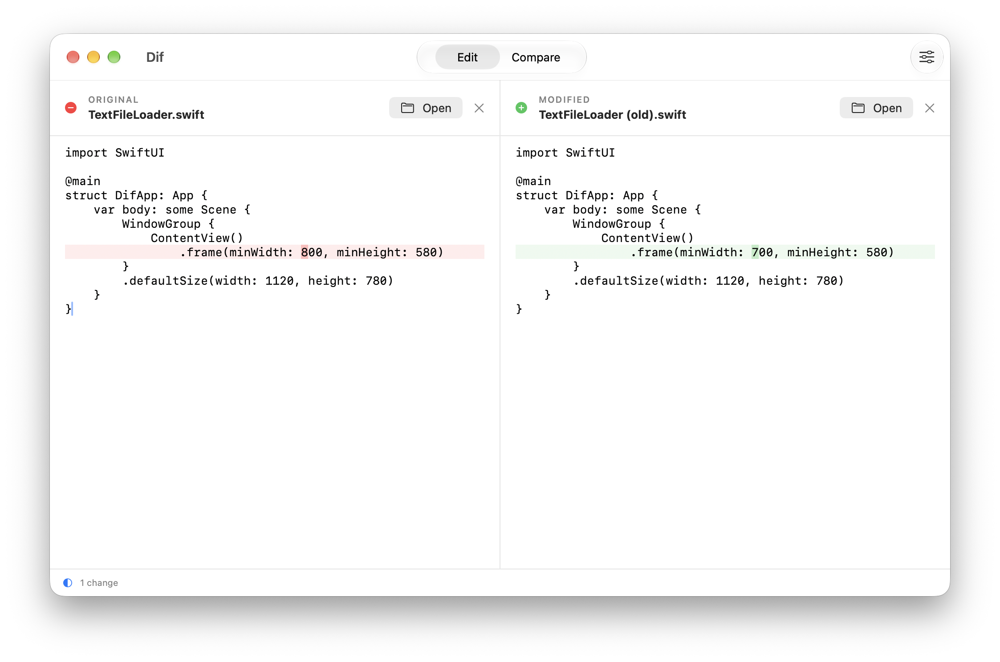

# Dif

Dif is a free native macOS app for comparing two pieces of text side by side.



Paste text or open files in the Original and Modified panes. Dif aligns the lines, highlights changes within them, and updates the comparison as you edit. Switch between **Edit** and **Compare** in the toolbar, and use **Comparison Options** to hide whitespace changes or disable line wrapping.

## Features

- 🔍 Aligns added, removed, and changed lines with highlights inside changed lines
- ✍️ Lets you edit text, name each side, and clear either pane
- 📂 Opens text files or accepts them by dragging them into a pane
- ⚙️ Can ignore whitespace changes and turn off line wrapping

## Requirements

- macOS 26.0 or newer

Dif has no third-party runtime dependencies.

## Install

Install with Homebrew:

```sh
brew install dotzero/tap/dif
```

Or install manually:

1. Download the latest `.dmg` from [Releases](https://github.com/dotzero/dif/releases)
2. Open the `.dmg` and drag Dif to your Applications folder
3. Launch Dif. If macOS blocks it, open **System Settings → Privacy & Security** and click **Open Anyway**

## Build From Source

Install Xcode, then clone the repository and build the app:

```sh
git clone https://github.com/dotzero/dif.git
cd dif
make build
open build/DerivedData/Build/Products/Debug/Dif.app
```

To run formatting checks and tests, install SwiftFormat and SwiftLint, then run `make check`.

## File Access

Dif only reads files you choose through **Open** or drag and drop. It supports UTF-8 and BOM-marked UTF-16 text; binary files and unsupported encodings are rejected. It does not write to your files or save your text and options.

## License

[MIT](https://opensource.org/license/mit)
